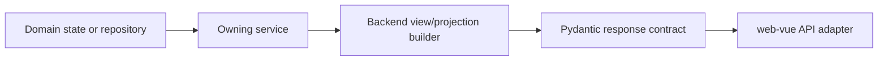

# Backend Map

Status: current

The backend exposes stable JSON projections and action results. It does not
render product HTML or transfer browser interaction ownership to Python.

## Entry points

[`../../api/app.py`](../../api/app.py) assembles five routers:

| Router | Primary surface | Principal owners |
| --- | --- | --- |
| [`api/ai.py`](../../api/ai.py) | OpenAI-compatible text, search, image, Messages, Responses, and editable-file endpoints | Protocol services, `LoggedCall`, `EditableFileTaskService` |
| [`api/accounts.py`](../../api/accounts.py) | User Keys, Upstream Accounts, Account Groups, account operations, OAuth, CPA, and Sub2API | `AuthService`, `AccountService`, import services |
| [`api/image_tasks.py`](../../api/image_tasks.py) | Studio-owned asynchronous image task endpoints | `ImageTaskService` |
| [`api/prompts.py`](../../api/prompts.py) | Prompt Library reads and Prompt Source refresh/mutation | `PromptLibraryService` |
| [`api/system.py`](../../api/system.py) | Login, version/update, settings, gallery, logs, monitor, proxy, dashboard, backup, and storage operations | Corresponding domain services and view builders |

Routers authenticate, validate transport contracts, translate expected domain
errors to HTTP responses, and call an owning service. They must not become a
second implementation of service state transitions.

### Model catalog and image compatibility

`ModelCatalogService` defaults chat models to `gpt-5.6` and `auto` and retains
explicit configured overrides. The console and `/v1/models` consume the same
catalog; listing models does not query upstream or append upstream-only entries.

`utils.helper.WEB_IMAGE_MODELS` owns the built-in Web image identifiers:
`gpt-image-2`, `gpt-image-2.5`, `gpt-image-2.5-flare`,
`gpt-image-2.5-sunburst`, `gpt-image-2.6`, `gpt-image-2.6-flare`, and
`gpt-image-2.6-sunburst`. Model validation and `ModelCatalogService` consume this
list; Studio consumes the backend catalog. Explicit catalog configuration still
takes precedence over the built-in list. No `exact` aliases are added.

The persisted `gif_models` setting controls GIF and SVG eligibility per image
model. It defaults to the three 2.6 aliases and is projected through
`/api/settings`.
The persisted `image_max_n` setting defaults to four and has a minimum of one.
`utils.helper.parse_image_count` owns the configured request limit; image APIs
and Studio task admission share it, while the model catalog projects the limit
to Studio. JSON counts remain strict integers. Historical tasks retain their
original count when the configured limit is later lowered.
Image requests carry optional `output_format`, `frame_count`, and
`frame_duration_ms` values through the shared image execution request.
`validate_image_parameters` normalizes all image entry points before upstream
work or task admission. `complexity` is rejected; quality is a prompt hint.
GIF counts are integers 2..60, durations 10..60000 milliseconds in multiples
of ten. Numeric form strings are normalized, other invalid values rejected.
The canvas parser bounds dimensions and area; GIF canvases are at most 2048
per side with 32 megapixels of aggregate decoded frame area.

`output_format` accepts `gif`, `png`, `jpg`/`jpeg`, `webp`, and `svg`.
The shared formatter selects one GIF animation per generation slot and excludes
storyboard PNGs. `normalize_gif_output` uses the existing bounded Pillow worker
and worker semaphore to validate motion, exact requested frame count and timing.
It fits the canvas without cropping and applies requested frame durations,
without manufacturing frames. It preserves encoded bytes when already compliant.
Changed output discloses canvas/timing processing in public `processing` metadata.
The wrapper checks complete GIF/SVG cardinality before yielding any result;
non-raw raster partial-result behavior is unchanged.

SVG generation uses the text account pool for generation requests only;
reference images and streaming are rejected. Size/quality enter its prompt.
The result is validated as bounded static XML; `utils.svg` resolves physical
units at 96 CSS pixels per inch and can fit a requested pixel canvas, preserving
the viewBox content. Stored types remain `.svg` / `image/svg+xml`.
Other explicit formats continue using the raster conversion/enlargement path.

`image_output_invalid` is a terminal delivery failure: it does not switch
accounts or trigger internal regeneration. Direct HTTP errors carry
`x-should-retry:false`. A gateway must separately exclude this error from retry
and verify reservation refunds; a header alone does not configure NewAPI.
Image usage is labeled `source: local_estimate` and uses delivered assets only.
Frame parameters and processing facts enter Call Records; route selection
events log the requested alias and actual upstream slug with the call ID.

Image results carry the MIME type detected from the final encoded bytes so
Chat data URLs match GIF, PNG, JPEG, or WebP output.

The management gallery projects origin-relative `/images/` and
`/image-thumbnails/` URLs through `gallery_row`. Console aliases therefore read
assets through their own application origin, including WebDAV-backed assets.
Published generation URLs still follow `ImageStorageService` public URL settings.

The 2.5 and 2.6 identifiers use the existing `auto` upstream Web model slug. They are
compatibility names and do not force a particular official API image engine or
quality entitlement. Existing `gpt-image-2` and Codex routing and the default
image model remain unchanged.

### Optional image enlargement

`services.image_upscale_service.upscale_image_if_needed` owns interpolation,
geometry, admission, and fallback. `format_image_result` passes the request
deadline and Call Record identifier before using the existing image-storage seam.
SettingsManagementService projects `image_upscale_fit` (`contain` by default,
or centered `cover`) alongside the existing enable and engine settings.

Sharp and Pillow run as isolated child processes with at most two active workers
per application process, a five-second queue wait, and a shared 60-second budget.
The request deadline further caps that budget with a two-second return reserve.
Inputs are limited to 32 MiB / 32 megapixels; targets to 8192 per dimension and
32 megapixels. Encoded output is verified and capped at 64 MiB. Animated images
and unsuccessful enlargements retain the original bytes. Sharp can fall back
once to Pillow within the same budget. No AI model is involved.

The service emits safe per-image diagnostics through private `_image_upscale`
metadata. `image_output_metadata` carries this into Call Record `result_images`;
`request_detail_view` owns its readable projection. The existing response filter
removes private metadata for ordinary and streaming API responses. No account,
asset, request, or Call Record lifecycle is duplicated by the renderer.

### Upstream Account memory

`POST /api/accounts/memory` starts an administrator-only `enable`, `disable`,
`refresh`, or `clear` operation using existing selection and progress interfaces.
The `memory_state` filter is shared by listing,
pagination, selection preview and filtered batch/export membership. Empty selections are rejected and target IDs
are fixed before the background worker starts.

`AccountService.manage_account_memory` owns credentials, shared processing
capacity, per-account mutation and stored snapshots. `OpenAIBackendAPI` owns
the upstream `m3m` and saved-memory clearing protocols and verification.
`account_view` independently projects the switch snapshot, clear record and
allowed actions; `account_operation_events` distinguishes confirmed,
pending verification and failed results. Metadata remains in the Account
Repository without storing memory contents; progress retains the existing
process-memory lifecycle. Account-local mutual exclusion applies within one
process, while credential and operation compare-and-swap guards reject stale
metadata writes. It does not serialize upstream calls across processes.
See [critical-flows.md](critical-flows.md#upstream-account-memory-maintenance)
for verification and protocol evidence.

## Domain and persistence ownership

| Domain | Owning Module | Stable Interface/output | Persistence |
| --- | --- | --- | --- |
| Upstream Accounts and User Keys | `AccountService`, `AuthService` | Account/auth projections and batch action results | Account Repository through `DatabaseStorageBackend` |
| Settings and policy | `SettingsManagementService`, runtime configuration | Effective settings projection and mutation result | `SystemSettingsRepository` |
| Proxy routing | `ProxyManagementService`, `ProxyService` | Proxy References, groups, tests, and runtime view | `ProxyConfigurationRepository` |
| Call Records | `LoggedCall`, `CallRecordService` | Call summary/detail projections | `CallRecordRepository` |
| Active Requests and live operations | `RealtimeMonitorService` | Snapshot and call-detail records | Process memory |
| Dashboard Metric Projection | `DashboardMetricsService` | 24-hour cards and 24h / 7d / 30d chart snapshots from one hourly projection | `DashboardMetricsRepository` with state, hourly, and per-model hourly tables |
| Runtime environment | `runtime_environment_service` | One runtime snapshot | No durable state |
| Image Tasks | `ImageTaskService` | Owner-scoped task projection and terminal result | `data/image_tasks.json` |
| Image Assets and gallery | `ImageStorageService` | Asset mutation, catalogue, storage, and public URL behavior | Local/WebDAV assets plus `data/image_index.json` |
| Editable File Tasks and Assets | `EditableFileTaskService` | Owner-scoped task commands and public asset resolution | `EditableFileTaskRepository` plus filesystem assets |
| Prompt Sources and Prompt Library | `PromptLibraryService` | Revisioned merged library and source health | `PromptLibraryRepository` |
| CPA/Sub2API imports | `CPAImportService`, `Sub2APIImportService`, `RemoteImportJobCoordinator`, `RemoteAccountImportJob` | One import-job lifecycle and final batch result | Remote-import configuration repository plus Account Repository |
| Online update | `UpdateStatusService`, `UpdateService` | Availability projection and update-task lifecycle | GitHub Release metadata, managed runtime directory, `data/update_task.json` |

The repositories share the engine created by
[`../../services/application_database.py`](../../services/application_database.py)
but retain separate domain interfaces and transaction ownership.

## Projection boundary

- A projection resolves precedence between persisted state, credentials, and
  runtime outcomes before returning final labels, tones, capabilities, and
  allowed actions.
- Contract models validate that output. Vue consumes it and owns presentation;
  it does not recompute the business decision.
- A command result represents the completed action or accepted asynchronous
  task. Polling and retry ownership must be explicit for asynchronous work.

## Shared infrastructure

| Module | Role | Boundary |
| --- | --- | --- |
| `services/application_database.py` | Resolves SQLite/PostgreSQL and owns shared SQLAlchemy engines | Infrastructure only; it does not merge repositories |
| `services/storage/factory.py` | Constructs the Account Repository adapter | It is not a global storage switch |
| `services/storage/file_lock.py` | Coordinates file-backed mutations | Used only by file-backed owners |
| `services/bounded_task_runner.py` and account-processing modules | Bound process work | Their capacity is not image-generation concurrency |
| `api/*_contract.py` | Stable transport validation | Contracts do not own domain state transitions |

Use [`critical-flows.md`](critical-flows.md) when a change crosses these
boundaries; use CodeGraph only to discover additional callers and verify them
against source.
